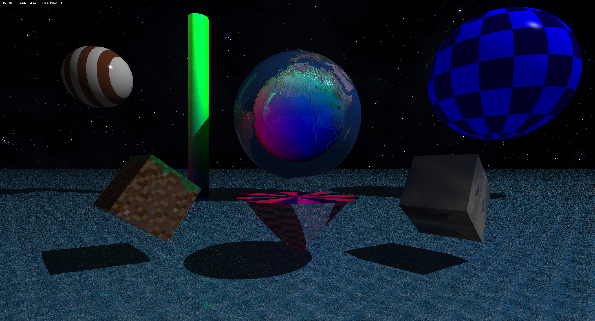

# miniRT

**My first RayTracer with MLX42**

This project is an introduction to Raytracing, inspired by and based on the concepts from the book ***The Ray Tracer Challenge*** **by Jamis Buck**. The goal of miniRT is to render computer-generated images using the Ray Tracing method. The project is written in C and uses the MLX42 graphics library.

## 📝 About the Project

This project implements a ray tracer capable of rendering primitive geometric shapes, handling shadows, textures, bump maps and applying different lighting models.

For complete project constraints and mandatory requirements, please refer to the official subject file: **en.subject.pdf**.

## ✨ Features

### Core Rendering

* **Geometric Objects:** Rendering of Planes (`pl`), Spheres (`sp`), Cylinders (`cy`), Cones (`co`), and Cubes/Boxes (`cu`).

* **Caps:** Cylinders and cones can be rendered with or without end caps.

* **Lighting:** Supports ambient lighting and one single directional light source to cast hard shadows and create spot brightness.

### Extended & Bonus Features

* **Advanced Lighting & Optics:** Specular reflection (Phong), pure reflection, transparency, and refractive index.

* **Textures & Mapping:** Support for external textures, bump mapping, and skyboxes.

* **Patterns:** Built-in procedural patterns (stripe, gradient, ring, checkers, test).

## 🛠️ Compilation & Installation

Ensure you have a C compiler (`cc`) and the necessary dependencies for MLX42 installed on your system (e.g., GLFW).

Clone the repository and compile the project using `make`:

```bash
git clone <your-repository-url>
cd miniRT
make
```

Available `make` commands:

* `make` / `make all`: Compiles the raytracer.

* `make bonus`: Compiles the raytracer with extended bonus features.

* `make clean`: Removes object files.

* `make fclean`: Removes object files and the executable.

* `make re`: Recompiles the entire project.

## 🚀 Usage

Run the program by passing a scene description file (`.rt` extension) as the first argument:

```bash
./miniRT scenes/example.rt
```

### 🎮 Interactive Controls

This implementation features a fully interactive environment. You can manipulate the camera, objects, and the light source directly in the viewport.

#### General & Camera

* **ESC / Red Cross**: Close the window and quit the program cleanly.

* **Arrow Keys / WASD **: Move the camera around the scene.

* **`e`**: Move camera relative up.

* **`q`**: Move camera relative down.

* **Hold Right Mouse Button & Move**: Look around the scene.

* **Hold `f` + Scroll**: Change the Field of View (FOV).

#### Object Manipulation

* **Left Mouse Drag**: Move the selected object across the screen (X/Y axes).

* **`Alt` + Left Mouse Drag up & down**: Move the selected object in depth (Z-axis).

* **Mouse Scroll**: Resize the object uniformly along all axes.

* **Hold `x` + Scroll**: Resize object along the X-axis only.

* **Hold `y` + Scroll**: Resize object along the Y-axis only.

* **Hold `z` + Scroll**: Resize object along the Z-axis only.

* **Hold `Left Shift` + `x` / `y` / `z`**: Rotate the selected object along the respective axis.

#### Light Manipulation

* **Hold `Left Control` + `x` / `y` / `z`**: Move the light source along the respective axis.

## 📄 Scene Configuration (`.rt` files)

The scene is configured via a `.rt` text file. Elements can be defined in any order, separated by spaces or newlines.

### Basic Elements

* **Ambient Lighting (`A`)**: `A <ratio 0.0-1.0> <R,G,B>`

* **Camera (`C`)**: `C <x,y,z coordinates> <3D orientation vector> <FOV>`

* **Light (`L`)**: `L <x,y,z coordinates> <brightness ratio> <R,G,B>`

### Advanced Parameter Reference

When defining objects, append these tags to the end of the line to apply advanced effects:

* `pattern:<type>` : Applies a procedural pattern (`stripe`, `gradient`, `ring`, `checkers`, `test`).

* `sp:<value>` : Specular light reflection coefficient.

* `re:<value>` : Reflection coefficient (mirror effect).

* `tr:<value>` : Transparency coefficient.

* `ri:<value>` : Refractive index (e.g., 1.5 for glass).

* `sh:<value>` : Shininess factor (specular highlight size).

* `texture:<path>` : Path to a standard texture image.

* `bump:<path>` : Path to a bumpmap image for surface detail simulation.

### Configuration Example with Advanced Tags

You can mix standard geometric definitions with advanced tags for textures, bump maps, and material properties.

```text
A 0.1                                   255,255,255

C 0,1,10        0,0,-1      90
L -40,50,0                  0.6         255,255,255

# Spheres with advanced optical properties, textures, and bump maps
sp 0,0,-20                  12.6        150,150,255 sp:0.5 re:0.5 tr:0.5 ri:1.5 texture:Textures/earthmap1k.png bump:Textures/bump.png
sp 10,0,-20                 12.6        150,150,255 sp:0.5 re:0.5 tr:0.5 ri:1.5 texture:Textures/earthmap1k.png bump:Textures/bump.png
sp 0,10,-20                 12.6        10,0,255    

# Plane with a procedural ring pattern and a bump map
pl 0,0,0        0,1,0                   255,255,255  pattern:ring 0,0,0  bump:Textures/bump.png

# Cylinder
cy 10,0,-20     0,1,0       2.0 8.0     255,255,255  pattern:test

# Cube / Skybox with specific shininess
cu 0,0,0        0,1,0       4.0 4.0     255,255,255 sh:220  texture:Textures/sky_box.png

# Cone with checkerboard pattern
co 0, 0,-40     0,1,0       3.0 6.0     255,255,0 pattern:check 75,15,10
```

## 📚 References

* **The Ray Tracer Challenge** by Jamis Buck - *A Test-Driven Guide to Your First 3D Renderer*

* **en.subject.pdf** - The official 42 School miniRT module subject (Version 9.0).
